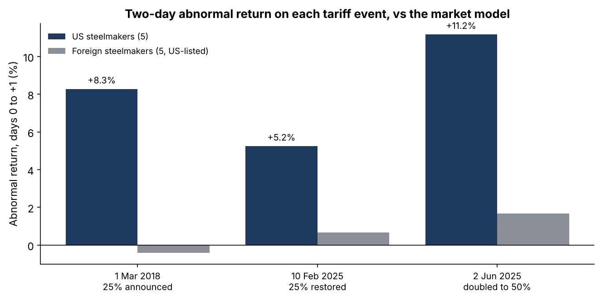
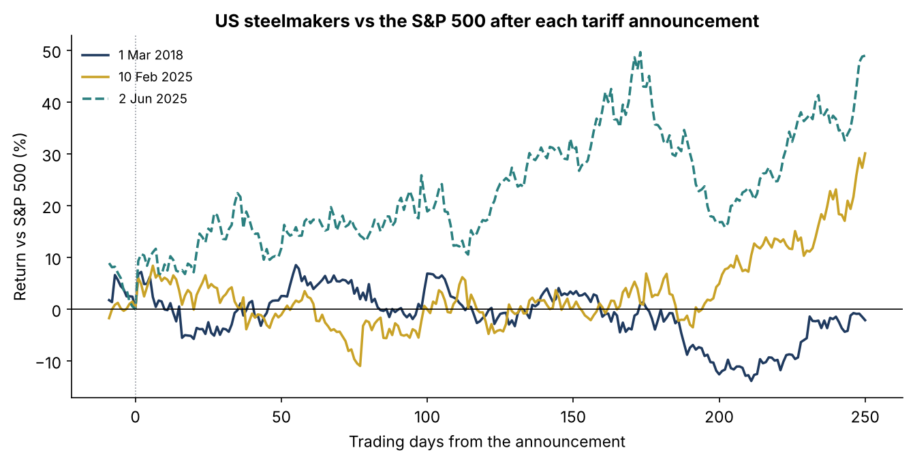
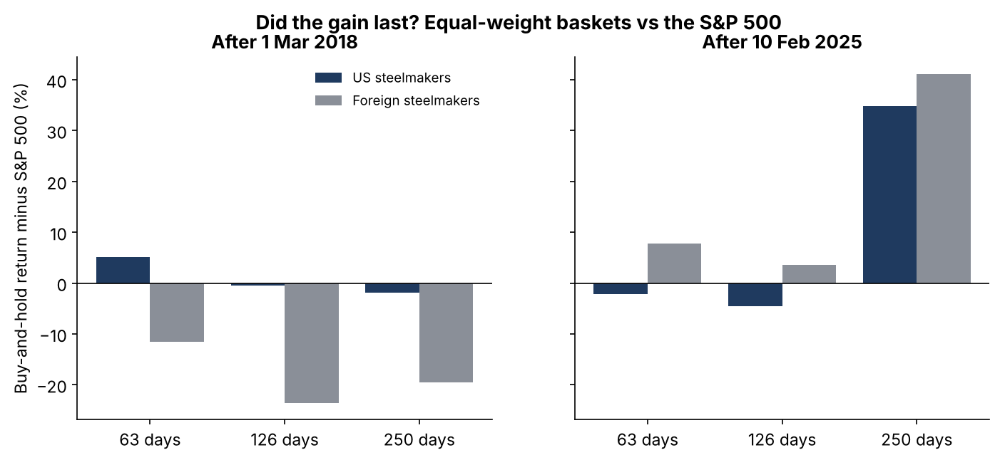
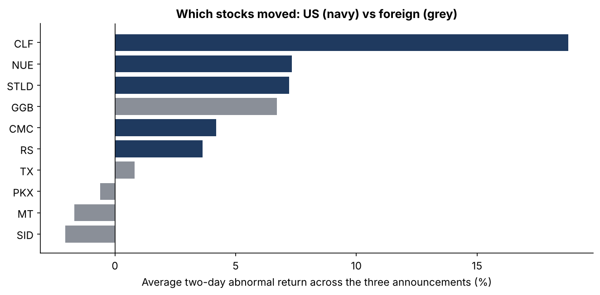

# Did steel tariffs pay steel shareholders? Four Section 232 events, 2018–2026

 

**Question.** When the US announces a Section 232 steel tariff, how much do steel stocks reprice, how fast, is anything left to earn afterwards, and does protection become lasting shareholder value?

**Answer, on real data.** Market-model event study on five US steelmakers (NUE, STLD, CMC, CLF, RS) and five foreign steelmakers listed in New York (MT, TX, GGB, SID, PKX), daily total returns.

- **Priced in two days, only for US producers.** Two-day abnormal returns: +8.3% (1 Mar 2018), +5.2% (10 Feb 2025), +11.2% (2 Jun 2025, doubling to 50%), t-statistics 4 to 8. Foreign steelmakers: −0.4%, +0.7%, +1.7%.
- **No drift after day two.** Days 2–20: −5.8%, +2.8%, +2.3%, none statistically significant.
- **Reversals are fast.** The 8 Mar 2018 signing, with Canada and Mexico exempted, took US steel down 6.6% in two days.
- **2018: the gain did not last.** The US basket was 1.9 points behind the S&P 500 a year later and 19.7 behind by November 2019.
- **2025: a big run, mostly the cycle.** Since 10 Feb 2025 US steel is 41.8 points ahead of the S&P 500 (to Oct 2026), but foreign steel was 41.2 points ahead at one year as well.

Full write-up: https://www.guptagaurav.info/articles/did-steel-tariffs-pay-steel-shareholders






## Method

- **Returns.** Daily total return = (close + dividend) / prior close − 1.
- **Events.** Day 0 = first session in which the news could be priced (see `configs/default.yaml`). The 30 May 2025 doubling was announced after the close, so day 0 is 2 Jun 2025. US Steel is excluded (Nippon Steel takeover; delisted Jun 2025).
- **Market model.** Each stock on SPY over trading days −260 to −21; a unit test checks the event never enters the estimation window.
- **Abnormal returns.** Actual minus expected; CARs over 0–1, −1 to +3, 2–20 and 0–10 days; Brown–Warner t-statistics. Group t-statistics assume independent residuals and overstate significance.
- **Robustness.** Two-factor model adding a base-metals fund (DBB); conclusions unchanged.
- **Long run.** Equal-weight buy-and-hold return minus SPY at 63, 126 and 250 days and to the end of the data.

## The commercial case

| Element | Detail (illustrative where stated) |
|---|---|
| Who pays | Metals and commodity desks, industrial/materials PMs, credit committees lending to steel producers or users, risk teams |
| Problem in dollars | A 5–11% two-day policy shock is $50–110M on a $1bn steel book; reversals of 6.6% in two days |
| Product | Policy-event risk monitor: event calendar, per-name shock estimates, stress scenarios, beta-vs-policy split |
| Proof | This repository |
| Build | 3–4 weeks per client universe (illustrative) |
| Pricing (illustrative) | $60–120k a year per desk |
| Adoption risks | Few events, each different; present shocks as ranges |

## Limits

Four events; overlapping tariff news in 2025; ten stocks; equity prices only (no steel prices or margins in this run). Independent research on public data. It is not investment advice and has not been deployed.

## Data and citations

Data
- Daily prices and dividends: [huggingface.co/datasets/defeatbeta/yahoo-finance-data](https://huggingface.co/datasets/defeatbeta/yahoo-finance-data) (ODC-BY), pinned by sha256 in `configs/default.yaml`.
- Event dates: Presidential Proclamation 9705 (8 Mar 2018) and the 1 Mar 2018 announcement; the 10 Feb 2025 proclamation restoring 25% for all countries; the 30 May 2025 announcement and 3 Jun 2025 proclamation raising the rate to 50% from 4 Jun 2025.

Methods
- Fama, E. F., Fisher, L., Jensen, M. C. and Roll, R. (1969). "The Adjustment of Stock Prices to New Information." *International Economic Review* 10(1), 1–21.
- Brown, S. J. and Warner, J. B. (1985). "Using Daily Stock Returns: The Case of Event Studies." *Journal of Financial Economics* 14(1), 3–31.
- MacKinlay, A. C. (1997). "Event Studies in Economics and Finance." *Journal of Economic Literature* 35(1), 13–39.
- Barber, B. M. and Lyon, J. D. (1997). "Detecting Long-Run Abnormal Stock Returns." *Journal of Financial Economics* 43(3), 341–372.

Code, analysis, charts and text were produced with AI assistance (Claude, by Anthropic) and reviewed by Gaurav Gupta.

## Run it

```bash
pip install -r requirements.txt
make all     # verifies the pinned files, runs the study (seconds)
make test
```

*Independent research on public data. Not investment advice. Dollar figures are illustrative.*
