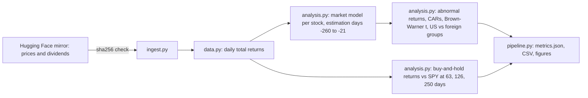

# Architecture

Modules: `ingest.py`, `data.py`, `analysis.py`, `figures.py`, `pipeline.py`. Tests: `tests/test_core.py` (market-model recovery, CAR isolates a jump, estimation window excludes the event, BHAR definition).
